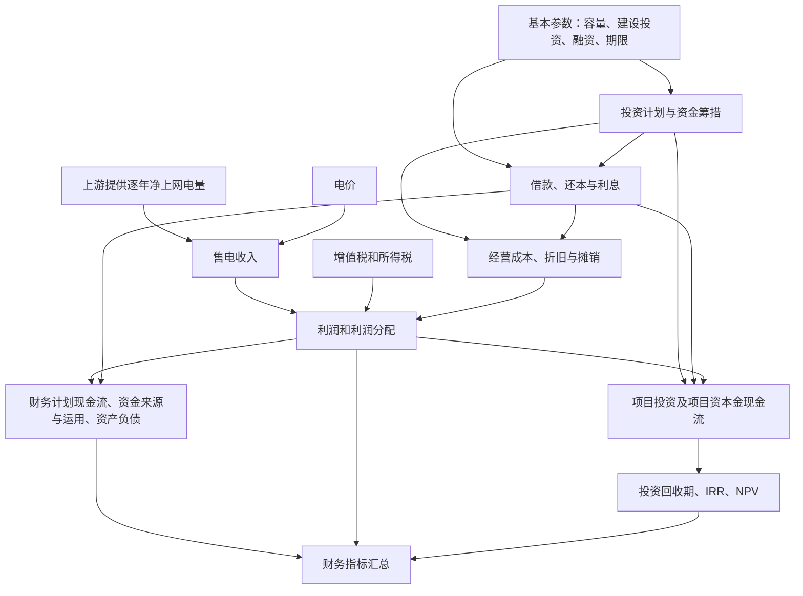

# WTG1 财务计算关系与 Python 原型

## 使用工程概算计算项目财务

在 REZoningAI 目录运行以下命令。两个 JSON 文件同属一组 50 MW 合成联调样例。

```bash
python3 -m finance.project_finance engineering_estimate/finance-integration-example.json finance/project-finance-example.json --summary
```

去掉 `--summary` 可查看原始分项、费用范围和逐年财务明细。Python 入口为 `finance.project_finance.calculate_project_finance(engineering_input, finance_input)`，它先计算工程概算，再将结果交给财务计算。原文件复算入口见下一节。

| 数据 | 接入后的处理 |
| --- | --- |
| 项目与装机容量 | 财务输入中的 `project` 与概算项目名匹配。装机容量直接来自概算，用于计算材料费和流动资金等容量定额金额。 |
| 静态投资和价差预备费 | 概算的含税静态投资与价差预备费相加，计入建设年资本支出。单独列示的基本预备费已在静态投资中。若概算提供分年计划，当前仅接受一个建设年；省略时，全部建设支出发生在建设年。 |
| 建设期用地和其他费用 | 财务端使用概算所列建设费用。旧表的 25 元/kW、建设期租地、征地、临时用地及地方支持费无需再填。需纳入的漏项应在上游补入概算，费用范围标为 `excluded` 的项目不会在财务端回填。 |
| 进项税和融资 | 财务侧显式填写可抵扣建设期进项税金额 `construction_input_vat_wan`，并用建设资本金比例和利率重算建设期利息。概算参考利息和财务利息分别列示。总投资包含建设支出、财务建设期利息和流动资金。 |
| 运营租金和售电量 | `operating_land_rent_wan` 为投运后 20 年实际另付的租金，单位万元。已在概算中预付的租金从相应运营年的输入中扣除。 `annual_grid_energy_mwh` 仍由上游提供，首项对应投运首年。 |
| 财务假设 | `financial_assumptions` 提供融资、电价、税率、成本定额等。应税和免税补贴按对应年度收到，并计入现金流。法定与任意盈余公积均体现在所有者权益内。 |

容县报批版概算仍有 **1,981.65 万元**静态投资差额。该输入会返回概算核对原因和差额，补齐或修正上游数据后可重跑。合成联调样例的含税静态投资为 **24,000 万元**、价差预备费 **100 万元**、财务建设期利息 **385.60 万元**、财务总投资 **24,635.60 万元**，税后项目 IRR 为 **9.9680%**。

当前接入支持 **1 年建设、20 年运营**。固定资产和折旧仍采用原模型的汇总基数规则，存在需单独摊销的土地使用权等资产时，应在正式应用前补充分资产类别的测算。历史所得税、亏损抵扣及流动资金借款期末余额的口径见下文。

## WTG1 原工作簿复算

适用范围为容县武威 50 MW 样本的 1 年建设、20 年运营、等比例投入资本金和等额本金还贷。模型从上游提供的逐年净上网电量开始，计算售电收入及财务概算。输出金额默认以万元人民币计，电量以 MWh 计，电价以元/kWh 计。字段后缀 `_pct` 使用百分数，例如 `4` 表示 4%。

```bash
cd /Users/chao/Documents/Coding/REZoningAI
python3 finance/wtg1.py finance/wtg1-base.json --summary
python3 finance/wtg1.py finance/wtg1-base.json
```

第二条 Python 命令输出原始输入、财务指标、21 年财务明细和校验结果。样本参数记录在 [wtg1-base.json](wtg1-base.json) 中，测算代码在 [wtg1.py](wtg1.py) 中。

应用内调用 `calculate(Assumptions(**financial_assumptions), annual_grid_energy_mwh=net_sales)`。样本 JSON 使用相同的两个字段。

| 输入 | 内容 |
| --- | --- |
| `annual_grid_energy_mwh` | 必填，由上游提供，按运营年排列的 20 个净上网电量，单位 MWh。首项对应投运首年，建设期无需填入。零值表示该年确实无售电量，缺失年份需要补齐数据。 |
| `financial_assumptions` | 投资、融资、成本、电价、税率等财务假设。装机容量用于把单位投资、材料费和流动资金定额换算成项目金额。 |

## 计算顺序



| 模块 | 原表依据 | 计算关系 |
| --- | --- | --- |
| 投资 | `基本参数!B4,B11:B15,B24`、`投资计划与资金筹措表!C5:E8` | 静态投资 = 装机 MW × 单位投资元/W × 100。建设期利息 = 静态投资 × 长贷利率 ×（1 − 建设资本金比例）÷ 2。动态投资 = 静态投资 + 建设期利息。流动资金 = MW × 元/kW ÷ 10。总投资 = 动态投资 + 流动资金。 |
| 资金筹措与债务 | `投资计划与资金筹措表!C10:E17`、`借款还本付息计划表!D5:AC17` | 动态投资与流动资金分别按各自比例拆分资本金和借款。长贷年还本金 = 长贷总额 ÷ 还款期。长贷利息按年初余额计算。流贷在首个运营年投入，按原表余额计息。 |
| 售电收入 | `利润和利润分配表!D5:X9`、`收入和税金!B25:V26` | 收入万元 = 上游提供的净上网电量 MWh × 对应电价 ÷ 10。样本含税电价为 0.3422 元/kWh，原表通过固定除数 1.13 得到不含税电价。 |
| 增值税与附加 | `基本参数!B15`、`利润和利润分配表!D10:X12,D31:X33` | 建设进项抵扣余额初值 = 静态投资 × 9.8%。销项税 = 含税收入 − 不含税收入。用剩余进项额度逐年抵扣销项，应缴增值税乘城建与教育附加合计费率。 |
| 成本 | `成本费用!B2:C4,B8:V8,B13:B29,B34:E43`、`总成本费用表!D5:X16` | 折旧基数为动态投资减建设进项税。按折旧年限直线摊至残值。维修、保险按静态投资减建设进项税计。人工按人数 × 工资 ×（1 + 福利比例）计。材料费按装机容量计。建设其他支出包含征租地、临时占地和地方支持等，运营其他支出取租地费用。经营成本 = 总成本 − 折旧 − 摊销 − 利息。 |
| 利润与实际所得税 | `利润和利润分配表!D14:X30`、`收入和税金!B33:B35,B55:V56` | 利润总额 = 不含税电费 − 附加税 − 总成本 + 应税补贴。按原表的亏损抵扣方式计算税基，所得税率按运营年度为前三年 0%、接着三年 12.5%、其后 15%。净利润再加免税补贴。 |
| 项目投资现金流 | `项目投资现金流量表!D5:X21` | 税前净流量 = 不含税收入 + 免税补贴 + 实际抵扣进项税 + 末期回收 − 静态建设投资 − 流动资金投入 − 经营成本 − 附加税。税后再扣调整所得税，税基取息税前利润，税率按运营年度为 0%、12.5%、25%。 |
| 项目资本金现金流 | `项目资本金现金流量表!D5:X17` | 沿用相同的现金流入，扣资本金投入、还本、付息、经营成本、附加税和实际所得税。 |
| 财务计划与资产负债 | `财务计划现金流量表!D5:AC38`、`资产负债表!C5:W26`、`资金来源与运用表!D5:AC25` | 经营、投资、筹资流量相加得到当年资金净流量，上年余额加净流量得到累计盈余资金。资产负债表据此滚动资金、固定资产、进项税余额、借款和所有者权益。资金来源与运用表另按利润总额、折旧摊销、融资和项目回收汇总资金来源与用途。 |
| 回报与偿债指标 | `项目投资现金流量表!C23:C28`、`项目资本金现金流量表!C19:C20`、`财务指标汇总表!D3:D27,F9,H9` | 三路现金流各算 IRR。NPV 沿用 Excel 年末折现，第一笔建设期现金流也折现一期，税前、税后、资本金基准率分别为 6.5%、6%、7%。静态回收期按累计现金流转正的年度插值。ROI = 年均息税前利润 ÷ 总投资，ROE = 年均净利润 ÷ 总资本金。利息备付率 = EBIT ÷ 利息，偿债备付率 =（EBITDA − 实际所得税）÷ 当期本息。 |
| 度电成本 | `收入和税金!D11:F16` | 使用原表自定义口径。分子取动态投资减折旧税盾现值、加税后维修费现值、减残值现值。分母取上游提供的净上网电量折现值。折现率 8%，运营项汇总 20 年，残值折现 25 年。修正项再乘以 `(1 + 13% × 50%) ÷ (1 − 25%)`。 |
| 附属分析 | `敏感性参数`、`EVA测算表`、`单因素敏感性分析表`、`敏感度系数和临界点分析表`、`边界条件-电建河北` | 敏感性结果多为固定零值，临界点页的 10.43% 是硬编码，EVA 为静态数值。河北边界条件含其他规模项目示例。由当前工作簿无法验证这些附表的动态计算规则。后续可以用同一模型重算情景，EVA 与边界反算需定义各自口径。 |

## 复算结果

| 指标 | 基准值 | 汇总表位置 |
| --- | ---: | --- |
| 项目总投资 | 23,277.56 万元 | D5 |
| 项目投资 IRR（所得税前 / 后） | 12.4072% / 10.9080% | D16 / D17 |
| 项目投资 NPV（所得税前 / 后） | 10,395.14 / 8,369.28 万元 | D18 / D19 |
| 项目投资回收期（所得税前 / 后） | 7.95 / 8.44 年 | D14 / D15 |
| 资本金 IRR | 29.3366% | D20 |
| 资本金 NPV | 10,138.43 万元 | D21 |
| ROI / ROE | 7.9682% / 29.0726% | D22 / D24 |
| 年产量盈亏平衡点 | 45,838.39 MWh | D27 |
| 原表度电成本 / 修正度电成本 | 0.2042 / 0.2900 元/kWh | F7 / H7 |

用 Artifact Tool 在内存中重算原工作簿，分别核对基准和四个单因素情景。每个情景比对 842 个数值，包括 23 项财务汇总、两项度电成本，以及期间成本、税、债务、三类投资现金流和资产负债明细。相对和绝对误差容限均为 `1e-7`。比对使用 Artifact Tool 公式引擎，尚待对照桌面 Excel 或原测算服务的结果。

| 逐项变更 | 税后项目 IRR | 资本金 IRR |
| --- | ---: | ---: |
| 含税电价降至 0.33 元/kWh | 10.3036% | 26.7750% |
| 单位静态投资升至 4.85 元/W | 9.9206% | 25.2029% |
| 首个运营年上网电量降至 100,000 MWh | 10.6994% | 27.7348% |
| 长贷利率升至 4.7% | 10.9108% | 27.0628% |

## 建设期其他费用复核

`成本费用!B34` 按项目规模和用地测算出 172.05998 万元。`总成本费用表!D12` 另加一笔运营期年租金，导致建设年实际计入 172.55996 万元。下面的费用都按原表口径复算。

| 费用 | 原表算法 | 金额（万元） |
| --- | --- | ---: |
| 其他费用定额 | 50,000 kW × 25 元/kW ÷ 10,000 | 125.00000 |
| 永久征地 | 11 亩 × 40,000 元/亩 ÷ 10,000 | 44.00000 |
| 建设期长期租地 | 60 亩 × 83.33 元/亩·年 × 1 年 ÷ 10,000 | 0.49998 |
| 临时占地 | 128 亩 × 200 元/亩·年 × 1 年 ÷ 10,000 | 2.56000 |
| 支持当地建设 | `成本费用!B36` | 0.00000 |
| 建设期其他费用合计 | `成本费用!B34` | 172.05998 |
| 建设年另计运营租金 | `成本费用!B35` 加入 `总成本费用表!D12` | 0.49998 |

1. **租地单价换算。** [项目指标配置表](</Users/chao/Desktop/容县武威 50MW 风电项目/AutoReport/可研报告-指标配置表.xlsx>) 的 `Sheet1!A144:F144` 明确写有 0.5 万元/亩，以及“200元/亩/年，25年”的说明。按配置说明，应把 5,000 元/亩除以 25 年。报表生成器用 5,000 除以 60 亩，得到原表的 83.33 元/亩·年，并把该值同时传给建设期和运营期。项目假设下年租应为 1.20 万元，实际付费年度仍由租赁合同决定。见 [financial-estimation-parameters.ts](/Users/chao/Documents/Coding/wind-power-auto-report/apps/cli/src/utils/financial-estimation-parameters.ts:205)。
2. **租金入账时点。** 原表每个运营年都按年计租，建设期本身又已有一笔建设期租金。若按年支付，建设年只计建设期租金。若合同要求在建设期预付投运首年租金，现金计划应挪动付款年度，并冲掉该运营年的重复现金支出。
3. **建设成本归集。** `总成本费用表!D12` 通过 `D16` 作为经营成本进入投资和资本金现金流，也进入建设期损益。它没有进入 `投资计划与资金筹措表!C6` 的建设投资和融资基数。[同批次可研报告第 12 章](</Users/chao/Desktop/容县武威 50MW 风电项目/AutoReport/Result/Xihe_Auto_Report_容县武威 50MW 风电项目_可研报告_报批版.docx>) 把建设用地费列在工程概算的其他费用内，但施工辅助、设备及安装、建筑、其他费用和基本预备费五项相加为 24,745 万元，与报告及财务表采用的 22,763.35 万元静态投资差 1,981.65 万元。现有资料只能确认两处存在范围重叠，无法逐项核实 44 万元征地费、2.56 万元临时用地费及其他分项在 22,763.35 万元里的实际覆盖情况。财政部的固定资产准则规定，自行建造资产达到预定可使用状态前的必要支出构成成本。具体项目应按费用性质判断归属。见 [企业会计准则第 4 号](https://kjs.mof.gov.cn/zt/kjzzss/kuaijizhunzeshishi/200806/t20080618_46213.htm)。
4. **25 元/kW 定额。** 原表主公式中的单位换算正确，125 万元是项目采用的简化定额金额。该定额的覆盖清单尚待确认。工作表备注“25–30 元/kW”缺少引用依据。`成本费用!E34` 另有以 100 MW 为例的公式，按 25 元/kW 算成 250,000 万元，正确值应为 250 万元。该旁算未进入主计算链。

保持静态投资和其余口径，按 200 元/亩·年并移除建设年多列的运营租金，内存重算得到建设年其他费用 172.76 万元、运营期年租 1.20 万元，项目税后 IRR 从 10.9080% 变为 10.9043%，资本金 IRR 从 29.3366% 变为 29.3208%。这组结果用于隔离租金问题。正式财务概算应先核对静态投资明细，已含费用通过建设投资体现，确属漏项的建设支出按性质补录并纳入融资测算，经营期租金按合同计入付款计划。

## 接入前确认的财务口径

1. **售电量交接。** 样本值来自 `利润和利润分配表!E5:X5`。Agent 从上游电量模块读取目标方案的逐年净上网电量，并随财务测算记录方案版本、来源和单位。
2. **税率和亏损抵扣。** 填写区中 25% 和“三免三减半”与实际纳税行的 15% 尾段并存。项目税后与资本金的所得税分开计算。亏损抵扣公式仅查五个计算年度前的利润，基准中建设期亏损在第 6 个计算年抵扣。调整所得税直接乘 EBIT，亏损情景可能产生负的调整所得税。正式规则需确认税率生效条件、可抵扣亏损余额、到期方式与税收优惠。增值税参数在原表中未驱动 1.13 的固定除数，原型把计算含税和不含税价格的 VAT 税率设为显式输入。度电成本保留原表固定修正参数。
3. **期末回收与偿债。** `项目投资现金流量表!X8:X9` 在第 21 个计算年回收残值和全部流动资金。`借款还本付息计划表!AC14` 在第 26 年才列流贷本金，资本金现金流到第 21 年就结束。基准末期仍有 105 万元流贷余额，原型将余额返回到 `checks`。若正式口径要求在第 21 年同步归还本金，需经业务确认后更新并重新计算资本金收益。
4. **期间长度与费用分类。** 主表用 1+20 年，多处标题延伸至第 26 年。盈亏平衡计算把成本按 25 年分摊，备付率均值固定取前 15 个运营年。摊销引用 `总成本费用表!B28` 空白，样本无形和其他资产均为零。正式模型增加多年建设、分批并网、其他资产和储能时，应定义建设投资分期、各项资产基数和回收规则。
5. **无定义的指标。** 原型在除数为零时返回 `null`。回收期取首次达到零或转正，无回收返回 `null`。出现多次现金流正负号转换时，IRR 返回 `null`，以保留多解或无法确定的状态。原表可给出不同的边界结果。正负号约定为净流入为正、净支出为负，费用明细以正数列示。

## Agent 接入建议

将 `calculate(assumptions, annual_grid_energy_mwh=net_sales)` 作为 Python 计算核心，保留 CLI 供复核和回归。若 Agent 与模型在同一 Python 服务内，直接注册函数即可。若模型要供风电 Agent、光伏 Agent 和独立客户端调用，给同一函数包一层 MCP。若已有报告服务继续提供 REST 接口，可令 REST 与 MCP 调用同一计算核心。相邻的自动报告工程已有通过 HTTP 获取财务 Excel 和 JSON 的调用，替换服务前可复用它做结果对照。见 [wind-power-economy.service.ts](/Users/chao/Documents/Coding/wind-power-auto-report/libs/services/src/lib/wind-power-economy.service.ts:20)。

首个工具可定为 `calculate_project_finance`。请求包含项目方案版本、财务模型版本、逐年净上网电量、投资和融资参数、税率及来源。返回指标、年度现金流和需核对事项。若宿主只需要摘要，年度明细可以作为同一次运行的独立查询结果。录入或识别参数后，Agent 调用确定性工具；报告环节使用同一次运行的结构化结果。建议先用 stdio 在本地验收，跨服务共享时采用 Streamable HTTP。见 [MCP 官方 Python SDK](https://github.com/modelcontextprotocol/python-sdk)。

下一步有两个可选业务目标。复算旧报告时，以本样本和更多真实工作簿建立回归用例。用于新项目投资决策时，先由财务确认期末还贷、税收优惠和亏损抵扣口径，再把确认后的风电与光伏规则建为有版本的正式模型。本次交付为 Python 原型和口径说明，MCP 服务与 Agent 联调尚待实施。

## 国电投工程概算接入

现有自动报告工程的风电概算服务按装机容量、地形和项目类型取数。客户端把响应 `budget_details` 中的施工辅助工程、设备及安装工程、建筑工程、其他费用和基本预备费相加作为工程静态投资。静态单位造价、动态单位造价来自独立字段，建设期贷款利息另行提取。旧财务加载器只读取静态单位造价，除以 1,000 后作为元/W 送入财务测算。报告章节的概算分项还可以由配置逐项覆盖。这些路径可能引用不同的金额。见 [概算服务](/Users/chao/Documents/Coding/wind-power-auto-report/libs/services/src/lib/cost-estimation.service.ts:23)、[旧财务加载器](/Users/chao/Documents/Coding/wind-power-auto-report/apps/cli/src/loaders/economy.loader.ts:103)及[报表分项取数](/Users/chao/Documents/Coding/wind-power-auto-report/apps/cli/src/services/techno-economic-analysis.service.ts:462)。

本次核对使用现有客户端代码、项目配置、报告及缓存数据。后台算法、服务当前返回和国电投原始基准表版本尚未核实。若手头的国电投材料是《新能源电站单位千瓦造价标准值》一类造价对标指标，可用于早期方案情景和造价校核。正式财务评价应使用项目适用的静态概算。上市公司公开的风电投资公告也同时列示项目静态投资及动态造价，并用集团造价标准作对照。见[电投能源投资公告第 2 页](https://static.cninfo.com.cn/finalpage/2024-10-24/1221489698.PDF)。

| 概算交接项 | 财务模型处理 |
| --- | --- |
| 项目及方案标识、编制日期或价格基期、装机容量、金额单位和含税口径 | 随结果记录来源和版本。校验概算与上网电量属于同一项目方案和容量口径。 |
| 同一版本的静态投资总额、分项及单位造价 | 以经确认的静态投资及分期金额作为建设现金流。校验分项合计、总额和单位造价之间的勾稽关系。原型的换算为 `静态单位投资（元/W）= 静态投资（万元）÷ 装机（MW）÷ 100`。 |
| 其他费用明细及不含项 | 标注建设用地、征地和临时用地、项目管理、前期费等是否已含，也标明送出、储能等是否属于同一投资范围。已含项按静态投资入账一次，明确不含的必要支出经确认后补入。只提供其他费用汇总时，该项覆盖情况列为待核对。 |
| 年度建设投资、可抵扣进项税、资产类别 | 用建设投资计划分期付款，用可抵扣税额和固定资产、无形资产等分项计算对应基数。概算总额本身无法给出各项可抵扣税额。 |
| 概算建设期利息、动态投资 | 造价对标和结果勾稽。财务模型以同一静态投资、出资计划及实际融资条件计算建设期利息。若业务采用已经确认的建设期利息，应保证同一笔利息只计一次。流动资金按财务假设单列。 |
| 运营租金、售电量和电价 | 租金根据合同排付款计划，预付款与工程投资明细核对。给定的净上网电量和电价进入销售收入。 |

容县样本的概算分项 `540 + 16,191 + 4,044 + 3,604 + 366 = 24,745 万元`，50 MW 对应 **4,949 元/kW**。WTG1 的静态投资为 **22,763.35 万元**，对应 **4,552.67 元/kW**，差额为 **1,981.65 万元**。概算侧还列示建设期利息 **391 万元**。以下试算只替换静态投资，保留原财务原型的其余假设和费用规则，包括仍待核实归属的建设期其他费用，用于量化投资输入差异。

| 财务结果 | WTG1 基准 | 代入 24,745 万元静态投资 |
| --- | ---: | ---: |
| 建设期利息（万元） | 364.21 | 395.92 |
| 财务总投资（万元） | 23,277.56 | 25,290.92 |
| 税后项目 IRR | 10.9080% | 9.6152% |
| 资本金 IRR | 29.3366% | 23.9597% |

建议由同一个概算结果驱动财务测算和报告取数。Agent 可调用本文开头的项目财务入口，由它执行工程概算和财务测算。[独立工程概算模型](../engineering_estimate/README.md)输出静态投资、单位造价、费用范围及勾稽结果。[参考文献与确认清单](../engineering_estimate/参考文献.md)记录了集团基准表和行业编制依据的查核入口。容县样本应先核实原始概算总表及其他费用明细，确认差额来源，再形成项目正式测算参数。
